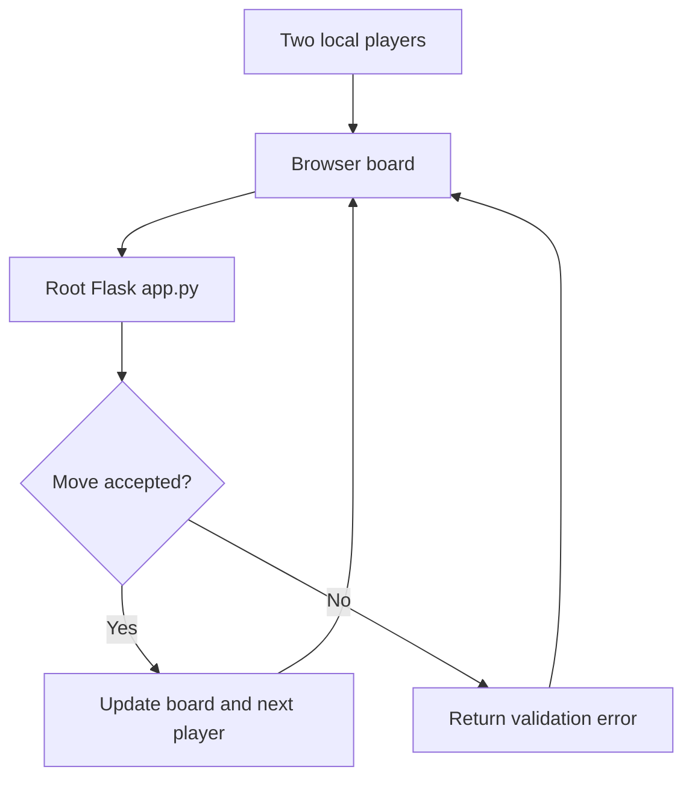

# Local Two-Player Chess — Flask

Local two-player browser chess application built with Flask, with separate desktop and account-based chess experiments retained in the repository.

## Project focus

Flask application. The sections below separate the runnable entry point, source layout, prerequisites, and verification path.

## Architecture



## Repository structure

| Path | Purpose |
| --- | --- |
| [`ChessGame/`](ChessGame) | Separate account-based Flask chess application. |
| [`LICENSE`](LICENSE) | Repository licensing terms. |
| [`app.py`](app.py) | Application entry point or route definitions. |
| [`snapshots/`](snapshots) | Project-specific source, resources, or learning material. |
| [`src/`](src) | Application or exercise source code. |
| [`static/`](static) | Browser styles, scripts, and static assets. |
| [`templates/`](templates) | Server-rendered HTML templates. |
| [`requirements.txt`](requirements.txt) | Python dependency manifest added for the runnable application or examples. |

## Getting started

```bash
git clone https://github.com/Raimal-Raja/chess_offline_two_players_flask_app.git
cd chess_offline_two_players_flask_app
```

```bash
python -m venv .venv
source .venv/bin/activate
```

On Windows PowerShell, activate the environment with `.venv\Scripts\Activate.ps1` instead.

```bash
python -m pip install -r requirements.txt
```

```bash
python app.py
```

## Configuration and scope

The root app implements local two-player browser chess. `ChessGame/` is a separate account/AI/Socket.IO application with its own requirements; `src/` retains desktop experiments and needs Pygame. These modes do not share one verified deployment configuration.

## Verification

Use the setup commands and inspect the selected interface, example, or notebook with known inputs. This documentation review checks repository paths and dependency declarations; it does not claim fresh end-to-end execution or model-quality measurements.

## Contributing

Include reproduction steps, the affected path, expected behavior, and the checks you ran. Keep credentials, generated environments, and unnecessary build artifacts out of commits.

## License

See [LICENSE](LICENSE) for the repository's license.
